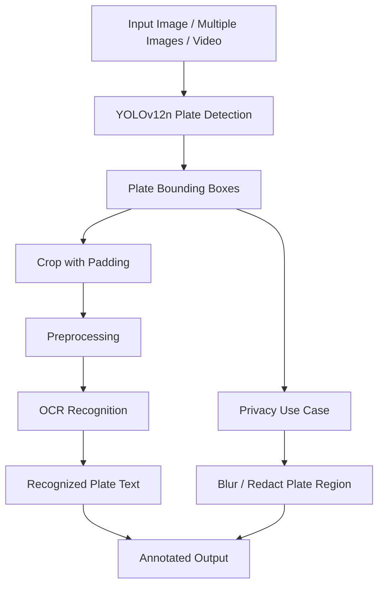
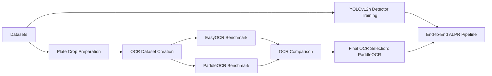
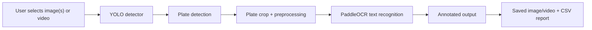
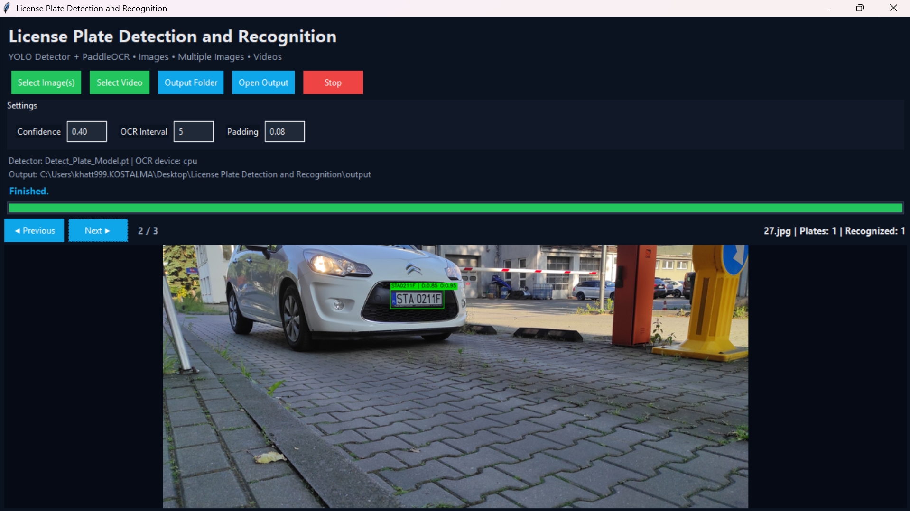

# License Plate Detection and Recognition

Automatic License Plate Recognition (ALPR) project using **YOLOv12n** for license plate detection and **PaddleOCR** for text recognition, with support for **images, multiple images, videos, privacy blurring, and a Tkinter desktop application**.

---

## Project Overview

This project implements a complete **license plate processing pipeline**.

It includes:

- **License plate detection** using YOLOv12n
- **Plate cropping and preprocessing**
- **OCR comparison** between EasyOCR and PaddleOCR
- **Final OCR selection** using PaddleOCR
- **End-to-end testing** on images and videos
- **Privacy use case** with automatic plate blurring
- **Desktop GUI application** for local image/video processing

The project was developed in **Kaggle** and then extended into a **local desktop application**.

---

## Final Result

The OCR comparison showed that **PaddleOCR performs better than EasyOCR** on the prepared license plate OCR test set.

### Final recommended recognition pipeline

```text
Vehicle image/video frame
        ↓
YOLOv12n license plate detector
        ↓
Plate crop with padding
        ↓
Image preprocessing
        ↓
PaddleOCR
        ↓
Recognized plate text
```

---

## Main Features

- Detect **one or multiple license plates**
- Process:
  - single image
  - multiple images
  - traffic video
- Recognize text on detected plates
- Save annotated outputs
- Save CSV results
- Blur detected plates for privacy
- Use temporal OCR voting for more stable video recognition
- Run through a **Tkinter desktop GUI**
- Auto-load local detector and OCR models from the `models/` folder

---

## Project Workflow



---

## System Architecture

### Training and Research Workflow



### Application Workflow



---

## Repository Structure

```text
License Plate Detection and Recognition/
│
├── .venv/
├── models/
│   ├── Detect_Plate_Model.pt
│   └── latin_PP-OCRv5_mobile_rec/
│
├── Notebooks/
│   └── License-Plate-Detection-and-Recognition.ipynb
│
├── license_plate_gui.py
├── README.md
├── requirements.txt
├── .gitignore
└── resources.txt
```

### Important files

| File / Folder | Description |
|---|---|
| `license_plate_gui.py` | Tkinter desktop application |
| `Notebooks/License-Plate-Detection-and-Recognition.ipynb` | Full Kaggle workflow notebook |
| `models/Detect_Plate_Model.pt` | Trained YOLOv12n detector |
| `models/latin_PP-OCRv5_mobile_rec/` | Local PaddleOCR recognition model |
| `output/` | Saved annotated images, videos, and CSV files |

---

## Notebook Content

The notebook contains the full project workflow, including:

- dataset reading and visualization
- crop generation from multiple datasets
- YOLOv12n detector training
- detector evaluation
- EasyOCR vs PaddleOCR comparison
- OCR evaluation metrics
- testing on real images
- testing on traffic videos
- privacy blurring example
- final ALPR pipeline validation

---

## GUI Application

The desktop application allows local inference without Kaggle.

### GUI capabilities

- auto-loads the detector from `models/Detect_Plate_Model.pt`
- auto-loads the OCR model from `models/latin_PP-OCRv5_mobile_rec`
- supports image, multiple-image, and video input
- saves results by default into the `output/` folder
- allows browsing processed images one by one in the preview area
- shows large annotated preview output
- performs OCR on detected plates
- stabilizes video recognition with temporal voting

### GUI Screenshot




---

## Datasets

The project uses four datasets.

| Dataset | Role in the project | Link |
|---|---|---|
| License Plate Dataset (LPD) — Ronak Gohil | YOLO detector training and validation | Add URL here |
| Car Plate Detection (CPD) — Andrew MVD | Plate crop extraction, qualitative testing, and plate blurring demo | Add URL here |
| Poland Vehicle License Plate Dataset (PVLP) | OCR dataset preparation and OCR evaluation | Add URL here |
| European License Plates Dataset (ELP) | OCR dataset preparation and OCR evaluation | Add URL here |

### Important dataset note

The **published detector model** was trained using the **LPD detection dataset configuration**.

The other datasets were used in the broader project for:

- crop generation
- OCR dataset preparation
- OCR benchmarking
- qualitative testing
- pipeline demonstrations

---

## Phase A — License Plate Detection

### Objective

Detect the location of one or more vehicle license plates in a full image.

### Detection model

- Model: **YOLOv12n**
- Task: single-class object detection
- Class: `license_plate`
- Input size: **640 × 640**
- Framework: **Ultralytics / PyTorch**

### Training configuration

- epochs: **40**
- batch size: **16**
- optimizer: **AdamW**
- learning rate: **0.0005**
- data augmentation: **enabled**
- cache: **disk**
- random seed: **42**
- GPUs: **2 × Tesla T4**

### Detector metrics

| Metric | Result |
|---|---:|
| Precision | **0.992** |
| Recall | **0.994** |
| mAP@50 | **0.995** |
| mAP@50–95 | **0.863** |

---

## Phase B — Plate Crop and Preprocessing

### Objective

Prepare the detected plate region for OCR.

### Workflow

```text
Plate bounding box
       ↓
Padding
       ↓
Safe crop
       ↓
Aspect-ratio-preserving resize
       ↓
CLAHE contrast enhancement
       ↓
Mild sharpening
       ↓
OCR-ready plate image
```

### Final preprocessing mode

The final selected preprocessing mode is:

```text
Enhanced
```

This includes:

- resize
- local contrast enhancement with CLAHE
- mild sharpening

---

## Phase C — OCR Comparison

### OCR models compared

| Model | Role |
|---|---|
| EasyOCR | Baseline OCR model |
| PaddleOCR | Final selected OCR model |

### OCR evaluation metrics

| Metric | Meaning |
|---|---|
| Exact Match Accuracy | Full plate prediction matches the ground truth |
| Character Error Rate (CER) | Character-level edit error |
| Character Accuracy | One minus CER |
| Mean Confidence | OCR confidence score |
| Mean Inference Time | Average runtime per plate |

### Result

**PaddleOCR outperformed EasyOCR** and was selected as the final OCR model.

---

## End-to-End Pipeline

The final system performs:

```text
1. Load image or video
2. Detect plates using YOLOv12n
3. Crop plate with padding
4. Preprocess the crop
5. Recognize text using PaddleOCR
6. Save annotated output
7. Save CSV results
```

### End-to-end output includes

- plate bounding box
- detection confidence
- OCR text
- OCR confidence
- video track stability score when applicable

---

## Privacy Use Case — Plate Blurring

This project also demonstrates **automatic plate anonymization**.

### Workflow

```text
Vehicle image
   ↓
YOLOv12n detection
   ↓
Plate region extraction
   ↓
Adaptive Gaussian blur
   ↓
Anonymized image
```

### Example use cases

- privacy-preserving dataset sharing
- anonymized traffic footage
- publishing vehicle photos
- research demonstrations

---

## Outputs

The project can generate:

| Output | Description |
|---|---|
| Annotated images | Images with detected plates and OCR text |
| Annotated videos | Videos with detected plates and recognized text |
| CSV reports | Plate predictions and confidence values |
| Blurred outputs | Privacy-preserving plate-blurred images |
| Detector model | YOLOv12n trained `.pt` checkpoint |
| OCR comparison results | EasyOCR vs PaddleOCR evaluation |
| Error analysis examples | OCR failure-case visualization |

---

## Installation

Clone the repository:

```bash
git clone https://github.com/drisskhattabi6/license-plate-detection-recognition.git
cd license-plate-detection-recognition
```

Create and activate a virtual environment:

### Windows PowerShell

```powershell
python -m venv .venv
.\.venv\Scripts\Activate.ps1
```

Install dependencies:

```powershell
python -m pip install --upgrade pip
python -m pip install -r requirements.txt
```

---

## Run the GUI App

```powershell
python .\license_plate_gui.py
```

The application will try to load:

- `models/Detect_Plate_Model.pt`
- `models/latin_PP-OCRv5_mobile_rec/`

If the detector file is missing, the app allows the user to manually select a `.pt` model.

---

## Models Required

### Detector model

```text
models/Detect_Plate_Model.pt
```

### OCR model folder

```text
models/latin_PP-OCRv5_mobile_rec/
```

Expected OCR model files include:

- `inference.json`
- `inference.pdiparams`
- `inference.yml`

---

## Limitations

- The detector was trained on the LPD detection setup and not on a single fully unified multi-dataset detector benchmark.
- OCR evaluation uses labeled crops from PVLP and ELP only.
- Recognition performance may decrease for:
  - very small plates
  - blurred plates
  - low-light scenes
  - strong reflections
  - tilted or occluded plates
- Video OCR accuracy depends on visibility across multiple frames.
- PaddleOCR is pretrained and not specifically fine-tuned for every possible license plate style.

---

## Future Improvements

- build a unified multi-source detector dataset
- fine-tune a plate-specific OCR recognizer
- improve video tracking with dedicated trackers
- add perspective correction before OCR
- add country-specific post-processing rules
- export ONNX or optimized inference formats
- deploy the app as a packaged desktop executable

---

## License and Data Notice

This repository license applies to the **source code only**.

Third-party datasets, pretrained weights, OCR models, and sample vehicle images remain subject to their original licenses and usage terms.

Users are responsible for checking:

- dataset licenses
- pretrained model licenses
- privacy regulations
- redistribution permissions

---

## Acknowledgements

This project uses:

- **Ultralytics YOLO**
- **PyTorch**
- **PaddleOCR**
- **OpenCV**
- **Tkinter**
- publicly available license plate datasets listed above

---

## Conclusion

This project presents a complete workflow for **license plate detection and recognition**.

- **YOLOv12n** detects license plates
- **PaddleOCR** recognizes the text
- the pipeline works on both **images and videos**
- a **Tkinter GUI** allows practical desktop use
- a **privacy blurring** workflow is also supported

### Final recommended pipeline

```text
YOLOv12n → padded crop → enhanced preprocessing → PaddleOCR → plate text
```